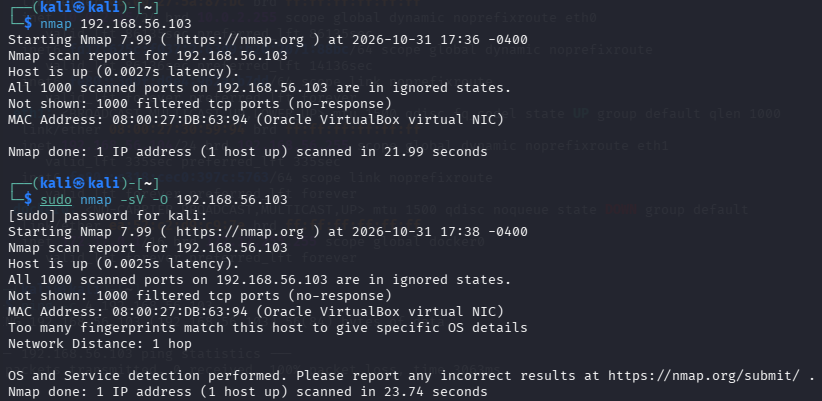
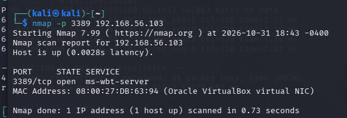
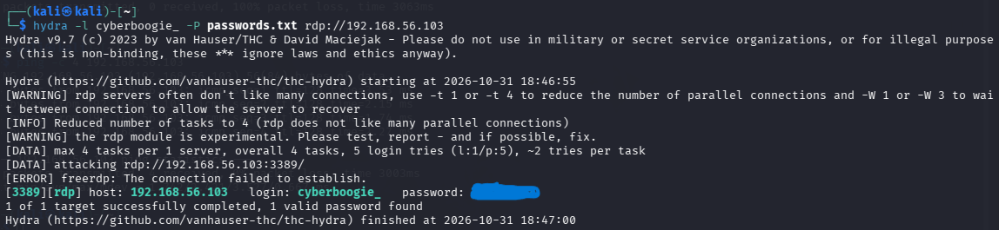
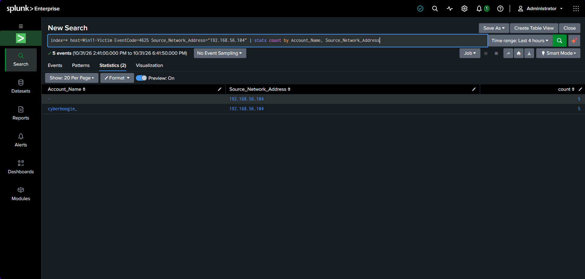

# SOC Home Lab: Brute-Force Attack Detection with Splunk

A hands-on blue team lab simulating a real-world RDP brute-force attack and detecting it with a Splunk SIEM. This project walks through the full cycle: attackers reconnaissance, service exploitation, credential attack, and analyst detection.

## Lab Architecture
| role | Machine | IP Address
|----|--------|--------------|
| Attacker | Kali Linux (VM) | 192.168.56.104 |
|Victim | Windows 11 (VM) | 192.168.56.103 |
| SIEM | Splunk Enterprise (host laptop) | 192.168.56.1 |

All machines run on a VirtualBox **Host-Only network** (192.168.56.0/24),
an isolated lab segment with no connection to the public internet. The
Windows victim runs the **Splunk Universal Forwarder**, shipping its 
Application, Security, and System event logs to the Splunk instance on the 
host for analysis.

## Tools Used

- **VirtualBox** - virtualization platform for the lab
- **Kali Linux** - attacker machine (Nmap, Hydra)
- **Windows 11** - target endpoint
- **Splunk Enterprise + Universal Forwarder** - SIEM and log collection
- **Nmap** - network reconnaissance
- **Hydra** - credential brute force tool

- ---

## Setup

### 1. Networking
Both VMs use two network adapters in VirtualBox:
- **Adapter 1 – NAT:** internet access (for downloading tools)
- **Adapter 2 – Host-Only Adapter:** the isolated 192.168.56.0/24 lab
network, using the same adapter name on both VMs so they can reach each
other

Verify connectivity with `ping` between the machines. Windows blocks ICMP
by default, so allow it on the victim:

netsh advfirewall add rule name-"Allow ICMPv4" protocol=icmpv4:8, any dir=in action=allow

### 2. Splunk (host laptop)
1. Install Splunk Enterprise on the host.
2. Enable receiving: **Settings > Forwarding and receving > Configure
3. receiving > New**, port **9997**.
4. Allow the port through the host firewall:
netsh advfirewall firewall add rule name="Splunk Receiving 9997" dir=in action=allow protocol=TCP localport=9997

### 3. Universal Forwarder (Windows victim)
1. Install the Splunk Universal Forwarder on the Windows VM.
2. Point the receiving indexer at the host: **192.168.56.1**, port **9997**.
3. During install, forward the **Application, Security, and System** event
   logs.
4. Confirm data is arriving in Splunk:
index=* | stats count by host, source

The victim's hostname should appear with `WinEventLog:Security`,
`WinEventLog:System`, and `WinEventLog:Application` sources.

> **Tip:** take a VirtualBox snapshot at each working milestone (clean
> install, forwarder connected, attack complete) so you can roll back
> instead of rebuilding.

---

## Attack-to-Detection Walkthrough

### 1. Reconnaissance
The attack begins with reconnaissance. From Kali, Nmap scans the victim to
map open ports and identify services. On a hardened Windows 11 host, the
firewall drops the probes and reports all ports as filtered, defeating
initial scanning.

nmap -sV 192.168.56.103

### 2. Service Exposure
Remote Desktop (RDP) is enabled on the victim to simulate a common
real-world exposure. A follow-up scan confirms **port 3389 is now open**,
giving the attacker a service to target.

nmap -p 3389 192.168.56.103

### 3. Credential Attack
Using Hydra with a small password list, the attacker brute-forces the RDP
login. Hydra works through the list and recovers the valid credentials for
the account.

hydra -l <username> -P passwords.txt rdp://192.168.56.103

### 4. Detection
The payoff. In Splunk, a search for Windows **Event ID 4625 (failed logon)**
reveals the attack. Grouping the failures by account and source IP exposes
the brute-force signature: a burst of failed logins from a single external
address (192.168.56.104, the Kali attacker) against one account.

index=* host=Win11-Victim EventCode=4625 Source_Network_Address="192.168.56.104" | stats count by Account_Name, Source_Network_Address

----

## Key Takeaways

- **Event ID 4625** is the core indicator for failed-logon and brute-force
  detection on Windows.
- The **Source Network Address** field is the analyst's pivot point: one
  external IP tied to repeated failures against a single account is a
  textbook brute-force pattern.
- Distinguishing attacker traffic (192.168.56.104) from normal internal
  noise (127.0.0.1, machine accounts) is a fundamental SOC triage skill.
- Centralized logging via a forwarder lets an analyst detect activity on a
  remote endpoint from a single SIEM console.

## Next Steps

- Convert the detection search into a **saved Splunk alert** that triggers
  on 5+ failures from one IP within a short window.
- Build a **dashboard** visualizing failed logons by source IP over time.

---

> **Disclaimer:** This lab was conducted in an isolated, self-owned virtual
> environment for educational purposes. Never scan or attack systems you do
> not own or have explicit permission to test.

## Attack-to-Detection Walkthrough

### 1. Reconnaissance
The attack begins with reconnaissance. From Kali, Nmap scans the victim to
map open ports and identify services. On a hardened Windows 11 host, the
firewall drops the probes and reports all ports as filtered, defeating
initial scanning.

### 2. Service Exposure
Remote Desktop (RDP_ is enabled on the victim to simulate a common
real-world exposure. A follow-up scan confirms **port 3389 is not open**,
giving the attacker a service to target.

### 3. Credential Attack
Using Hydra with a small password list, the attacker brute-forces the RDP 
login. Hydra works through the list and recovers the valid credentials for
the account.

### 4. Detection
The payoff. In Splunk, a search for Windows **Event ID 4625 (failed logon)**
reveals the attack. Grouping the failures by account and source IP exposes
the brute-force signature: a burst of failed logins from a single external
address (192.168.56.104, the Kali attacker) against one account.

*Detection query:**
index=* host=Win11-Victim EventCode=4625 Source_Network_Address="192.168.56.104" | stats count by Account_Name, Source_Network_Address

---

# Key Takeways

- **Event ID 4625** is the core indicator for failed-logon and brute-force detection on Windows.
- The **Source Network Address** field is the analyst's pivot point: one
- external IP tied to repeated failures aganist a single account is a textbook vrute-force pattern.
- Distinguishing attacker traffic (192.168.56.104) from normal interal
- noise (127.0.0.1, machine accounts) is a fundamental SOC triage skill.
- Centralized logging vvia a forwarder lets ana alsyst detect activity on a
- remote endpoint from a single SIEM console.

## Next Steps

- Convert the detection search into a ** saved Splunk alert** that triggers
- on 5+ failures from on IP within a short window.
- Build a **dashboard** visualizing failed logons by source IP over time.
